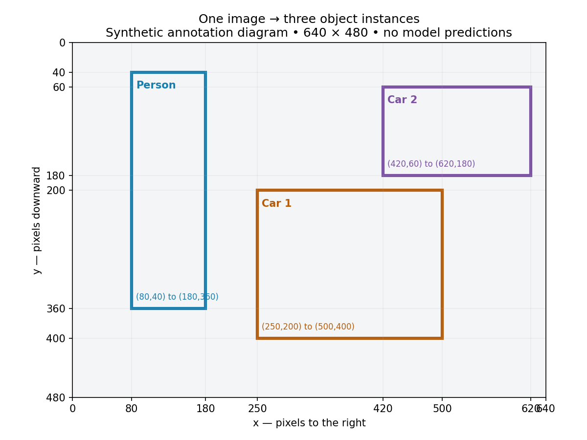

# Stage 1 — Detection is a variable-size set prediction problem

## Concept and why

Classification asks which category an image represents. Single-object localization adds one box. Detection must answer which objects exist, where each is, and how many instances exist. Two cars require two detections even though their class is the same.

For image `x ∈ R^(3×H×W)`, the target is an unordered set:

`Y = {(b_i, c_i)}_(i=1..N)`, where `b_i=(x1,y1,x2,y2) ∈ R^4`, `c_i ∈ {0,...,C-1}`, and `N≥0` varies by image.

Predictions are a scored set `Ŷ={(b̂_j,ĉ_j,s_j)}_(j=1..M)`. N and M need not match. Ground truth does not need predicted confidence. Correctness requires BOTH class and location; matching prevents one prediction from explaining two objects or duplicates from receiving repeated credit.

## Numerical scene

Synthetic annotation diagram, not model output: image W=640, H=480, origin at top-left, x increases right and y down. Coordinates use continuous pixel edges, not VOC XML indices.

| Instance | Class ID | xyxy pixels |
|---|---:|---|
| Person | 0 | (80, 40, 180, 360) |
| Car 1 | 1 | (250, 200, 500, 400) |
| Car 2 | 1 | (420, 60, 620, 180) |

Person width=180−80=100, height=360−40=320; its center is ((80+180)/2,(40+360)/2)=(130,200). These are pixel lengths, not probabilities. Box conversion and normalization are Stage 2.

Image tensor: `(3,480,640)`; boxes: float32 `(3,4)`; labels: int64 `(3,)`, values `[0,1,1]`. Second empty image has boxes `(0,4)` and labels `(0,)`. After consistent resizing, images can stack into `(B,3,H',W')`; targets remain a list of dictionaries because object counts differ. Do not introduce fake boxes merely to make the targets rectangular.

## Loss formulation preview

A predictor needs an assignment A between target objects and prediction slots, followed by a schematic objective:

`L = λ_box Σ_(matched) ℓ_box(b̂,b) + λ_cls Σ_(matched) ℓ_cls(p,c) + λ_obj Σ_(valid slots) ℓ_obj(o,z)`.

Here z marks whether an assigned slot contains an object; sums need explicit normalization later. This is a learning scaffold, not a universal equation for all detector families. Assignment, objectness semantics and each loss will be implemented in later stages.

## Guided implementation — your work

Create tensors for this image and an empty image using the shapes above. Put each image target into a dictionary with `boxes` and `labels`, and collect them in a list. Print shapes/dtypes. No model, coordinate converter or loss implementation yet.

Acceptance: exact box rows and class IDs, correct dtypes, correct empty shapes, and explanation of why targets cannot generally be stacked into `(B,N,4)` without a padding/mask policy.

## Short diagnostic (free response)

1. Why does an image-level label `car` fail to represent this scene?
2. What are the box/label shapes for a fourth object, also a car?
3. A prediction calls Car 1 a car but its box is far away. Is that a correct detection? Why?
4. Why should swapping the two car rows leave the meaning of the target unchanged?

Mini experiment: permute the three rows and labels together, then explain why the represented scene is identical. Takeaway to document after review: detection predicts instances as a variable-size set; classification alone cannot encode count or location.
